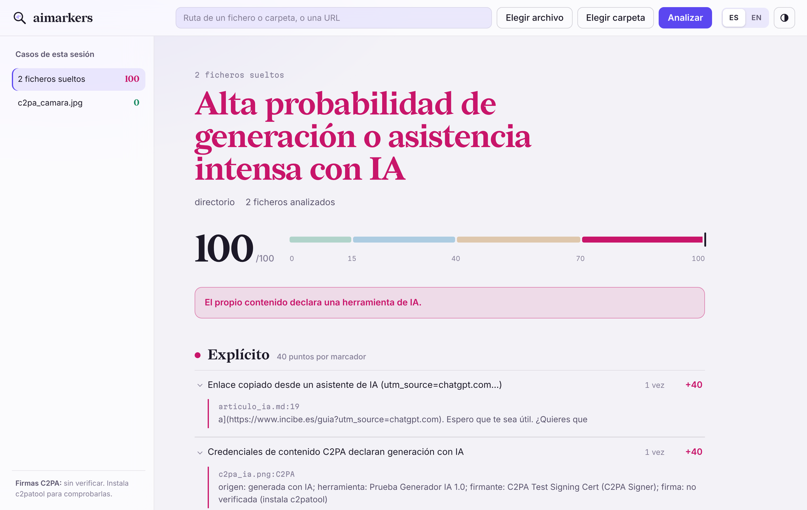
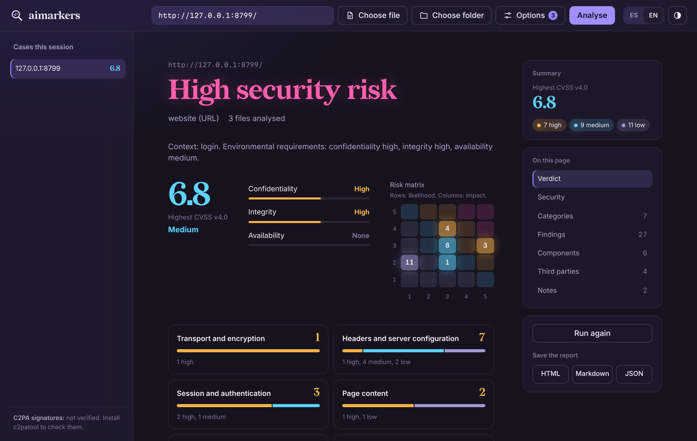

# aimarkers

[English](README.md) · **Español**

[](https://github.com/z115666/aimarkers/actions/workflows/ci.yml)
[](https://github.com/z115666/aimarkers/actions/workflows/codeql.yml)
[](LICENSE)


Herramienta de línea de comandos para buscar **marcadores de IA** en código fuente, documentación, webs (fichero HTML o URL), **imágenes** (credenciales C2PA, IPTC, EXIF y parámetros de generación) y repositorios Git. Puntúa cada indicio por niveles y genera un informe con las evidencias, en español o en inglés. También puede rastrear una web completa y hacer una **evaluación de seguridad** (OWASP Top 10:2025, MITRE ATT&CK, CVSS v4.0 y matriz de riesgos CID), que incluye secretos expuestos y **dependencias con vulnerabilidades conocidas** contrastadas con OSV.dev.

No le pregunta a un modelo de lenguaje si algo «suena a IA»: busca **evidencias comprobables** (declaraciones, huellas de herramientas y rasgos) y te dice dónde ha encontrado cada una. [Cómo decide](#cómo-decide) explica los criterios.

> Los marcadores son indicios, no pruebas. La herramienta ayuda a revisar; la conclusión la pones tú.

## Instalación

### macOS con Homebrew

```bash
brew install z115666/tap/aimarkers
aimarkers --version

# Opcional: verificación criptográfica de las firmas C2PA
brew install c2patool
```

Para actualizar: `brew update && brew upgrade aimarkers`.

### Cualquier sistema (Windows, macOS, Linux)

```bash
git clone https://github.com/z115666/aimarkers.git
cd aimarkers
python3 aimarkers.py --version
```

Requisitos: Python 3.9 o superior y, para analizar historiales, `git` en el PATH. Solo usa la biblioteca estándar: no hay dependencias que instalar. En Windows, mira la sección siguiente. Extras opcionales:

- [`c2patool`](https://github.com/contentauth/c2pa-rs/tree/main/cli), para verificar firmas C2PA.
- Pillow y NumPy, para la [lectura de píxeles](#lectura-de-píxeles) de las imágenes: `python3 -m pip install pillow numpy` (con Homebrew: `"$(brew --prefix python@3.15)/bin/python3.15" -m pip install --user --break-system-packages pillow numpy`). Sin ellos todo lo demás funciona igual.

### Windows

1. Instala Python y Git (PowerShell). Si usas el instalador de Python, marca **Add python.exe to PATH**; con `winget` se hace solo:

   ```powershell
   winget install --id Python.Python.3.13 -e
   winget install --id Git.Git -e
   ```

   Cierra y vuelve a abrir PowerShell, y comprueba: `py --version` y `git --version`.

2. Descarga aimarkers en la carpeta que quieras:

   ```powershell
   cd $HOME
   git clone https://github.com/z115666/aimarkers.git
   cd aimarkers
   py aimarkers.py --version
   ```

   Sin Git: en la página del repositorio, **Code → Download ZIP**, descomprímelo y abre PowerShell en esa carpeta.

3. Úsalo con `py` en lugar de `python3`, y con rutas de Windows:

   ```powershell
   py aimarkers.py C:\Repos\mi-proyecto
   py aimarkers.py "$HOME\Downloads\imagen.png" --lang es
   py aimarkers.py https://ejemplo.com --html "$HOME\Desktop\informe.html"
   start "$HOME\Desktop\informe.html"
   ```

4. Opcional: un comando `aimarkers` en todas las sesiones de PowerShell. Añade esta línea a tu perfil (`notepad $PROFILE`; si pregunta, crea el fichero):

   ```powershell
   function aimarkers { py "$HOME\aimarkers\aimarkers.py" @args }
   ```

   Si PowerShell no deja cargar el perfil, ejecuta una vez: `Set-ExecutionPolicy -Scope CurrentUser RemoteSigned`.

5. Opcional, para verificar firmas C2PA: descarga la versión para Windows de `c2patool` (`c2patool-…-x86_64-pc-windows-msvc.zip`) desde las [publicaciones de c2pa-rs](https://github.com/contentauth/c2pa-rs/releases), deja `c2patool.exe` en una carpeta del PATH y compruébalo con `c2patool --version`.

Para actualizar: `cd $HOME\aimarkers` y `git pull`. Los colores funcionan en Windows Terminal y en la consola clásica; usa `--sin-color` si ves caracteres raros. Para fijar el idioma: `$env:AIMARKERS_LANG = "es"` (sesión) o `setx AIMARKERS_LANG es` (permanente).

## Uso

Si lo instalaste con Homebrew, usa `aimarkers` en lugar de `python3 aimarkers.py` en los ejemplos.

```bash
# Un repositorio (analiza ficheros, imágenes, historial Git y ramas)
python3 aimarkers.py ~/Proyectos/mi-repo

# Ficheros sueltos
python3 aimarkers.py informe.md Limpiar-Temp.ps1

# Imágenes
python3 aimarkers.py foto.jpg ~/Descargas/*.png

# Una web por URL (descarga la página y sus imágenes y comprueba /llms.txt)
python3 aimarkers.py https://ejemplo.com

# Una web guardada con "Guardar como…"
python3 aimarkers.py pagina.html

# Informes
python3 aimarkers.py ./proyecto --html informe.html --md informe.md --json informe.json
```

### Idioma

La salida sale en el idioma del sistema (español si el *locale* empieza por `es`, inglés en otro caso). Para forzarlo:

```bash
aimarkers --lang en informe.md
AIMARKERS_LANG=es aimarkers informe.md
```

El idioma afecta a la consola y a los informes. Los identificadores de los marcadores (`coautor-ia`, `c2pa-ia`…) y las claves del JSON no cambian, para que los scripts que los usan sigan funcionando.

### Opciones

| Opción | Qué hace |
| --- | --- |
| `--html FICHERO` | Informe HTML autocontenido (modo claro y oscuro, legible en móvil) |
| `--md FICHERO` | Informe en Markdown |
| `--json FICHERO` | Resultado completo en JSON, con `resumen_por_marcador` |
| `--lang es\|en` | Idioma de la salida |
| `--evidencias N` | Evidencias mostradas por marcador (por defecto 3) |
| `--umbral N` | Sale con código 2 si algún objetivo llega a N puntos (útil en CI) |
| `--sin-imagenes` | No analiza las imágenes enlazadas desde las webs |
| `--silencioso` | No imprime el informe en consola |
| `--sin-color` | Consola sin colores |
| `--gui` | Abre la interfaz gráfica (ver más abajo) |
| `--rastrear` | Rastrea todo el sitio en lugar de una sola página |
| `--max-paginas N` / `--max-imagenes N` / `--retardo S` | Límites del rastreo (`-1` / `0`: sin límite) y pausa entre peticiones |
| `--seguridad` / `--solo-seguridad` | Añade el análisis de seguridad / hace solo el análisis de seguridad |
| `--activo --autorizado` | Modo de seguridad activo, solo con autorización (ver más abajo) |
| `--sin-dns` | Omite las comprobaciones de SPF, DMARC, DNSSEC y CAA |
| `--sin-osv` | No contrasta dependencias ni librerías JavaScript con OSV.dev |
| `--sin-pixeles` | Omite la lectura de píxeles de las imágenes |
| `--umbral-cvss N` | Sale con código 3 si algún hallazgo de seguridad llega a CVSS N |

Cada opción tiene también su nombre en inglés: `--evidence`, `--threshold`, `--no-images`, `--quiet`, `--no-color`, `--crawl`, `--max-pages`, `--max-images`, `--delay`, `--security`, `--security-only`, `--no-dns`, `--no-osv`, `--no-pixels`, `--active`, `--authorized`, `--cvss-threshold`.

## Interfaz gráfica

Para quien prefiera no usar la terminal, aimarkers incluye una interfaz gráfica que funciona entera en tu equipo:

```bash
aimarkers --gui                 # Homebrew
python3 aimarkers.py --gui      # macOS / Linux desde la carpeta
py aimarkers.py --gui           # Windows
```

Se abre en el navegador. Mientras trabaja muestra el porcentaje total, una estimación del tiempo que queda, cada fase del análisis y, con palabras sencillas, qué está comprobando en cada momento; **Detener análisis** lo cancela si lo has iniciado por error. Arrastra ficheros, carpetas o imágenes a la ventana, escribe una ruta o una URL, o usa **Elegir archivo** / **Elegir carpeta** (el selector del sistema). Cada análisis queda en la lista lateral durante la sesión y puedes guardar el informe en HTML, Markdown o JSON. Tiene apariencia clara y oscura (o la del sistema) y cambia entre español e inglés. Para cerrarla, pulsa Ctrl+C en la terminal.



Cómo se protege: solo escucha en `127.0.0.1` en un puerto aleatorio; cada petición necesita un token aleatorio de 256 bits que viaja en el fragmento de la URL; comprueba `Host` y `Origin` frente a DNS rebinding y otras webs; usa una política de seguridad de contenido estricta, sin scripts en línea ni recursos externos; los ficheros que sueltas van a una carpeta temporal (50 MB por fichero, 500 MB en total) que se borra al salir. Opciones: `--port N` y `--no-browser`.

## Rastrear una web completa

Por defecto aimarkers analiza solo la página que le das (y hasta 15 de sus imágenes). Con `--rastrear` descarga el sitio entero:

```bash
aimarkers https://ejemplo.com --rastrear                       # hasta 2.000 páginas, todas las imágenes
aimarkers https://ejemplo.com --rastrear --max-paginas -1      # sin límite de páginas
aimarkers https://ejemplo.com --rastrear --max-imagenes 200 --retardo 1
```

- Solo páginas del mismo sitio (con o sin `www.`) y solo por http(s).
- Respeta `robots.txt` y `nofollow`, y hace pausas entre peticiones (`--retardo`, 0,3 s por defecto) para no saturar el servidor.
- Todo se descarga en una carpeta temporal que **se borra al terminar el análisis**, también si falla. Límite total de descarga: 2 GB.

## Análisis de seguridad

`--seguridad` añade una evaluación de seguridad a cada objetivo; `--solo-seguridad` omite los marcadores de IA. Cada hallazgo incluye:

- Categoría de **OWASP Top 10:2025**, **CWE** y técnicas de **MITRE ATT&CK** que facilita.
- Efecto sobre la **triada CID** (confidencialidad, integridad, disponibilidad).
- Puntuación **CVSS v4.0** calculada dentro de la herramienta con el algoritmo oficial de FIRST (`cvss4.py`, comprobado contra la calculadora de referencia con 20.000 vectores). Cada hallazgo parte de un vector base tipo; la métrica de amenaza (E) refleja si hay exploits públicos, y los requisitos de entorno (CR, IR, AR) salen del **contexto de la web**: formularios de acceso, datos personales, pagos o subida de ficheros los elevan.
- Posición en una **matriz de riesgos 5×5** (probabilidad × impacto, al estilo ISO 27005): la probabilidad sale de la explotabilidad CVSS y la madurez del exploit; el impacto, del efecto sobre cada dimensión CID ponderado por el contexto.

**Webs, modo pasivo (por defecto).** Solo mira lo que recibe cualquier visitante: HTTPS y redirección, certificado y versión de TLS, HSTS, CSP, protección frente a marcos, nosniff, Referrer-Policy, Permissions-Policy, versiones expuestas, CORS, atributos de las cookies, contenido mixto, scripts de terceros sin SRI, librerías JavaScript con CVE conocidos (jQuery, jQuery UI, Bootstrap, AngularJS, Lodash, Moment, Handlebars), formularios por HTTP, contraseñas enviadas por GET, formularios sin token anti-CSRF, enlaces vulnerables a *reverse tabnabbing*, comentarios HTML sensibles, mensajes de error detallados, listado de directorios, claves y tokens expuestos, mapas de código, `robots.txt` y `security.txt`.

**Correo y DNS.** SPF, DMARC, DNSSEC y CAA del dominio, que protegen a familias y personal frente a correos que suplantan el dominio. Se consultan por DNS sobre HTTPS (Cloudflare, con Google como respaldo): solo se envía el nombre del dominio. `--sin-dns` los omite.

**Privacidad y terceros.** Lista los servicios externos que cargan las páginas (analítica, publicidad, vídeo, fuentes, mapas, CDN) y señala los rastreadores, Google Fonts y los vídeos de YouTube sin modo de privacidad, relevantes para el RGPD en webs con menores o datos personales.

**Inventario de componentes.** CMS, plugins y temas con su versión, librerías JavaScript, servidor web y lenguaje: un punto de partida para el inventario de activos y la gestión de parches.

**Resultados segmentados.** Los hallazgos se agrupan por categorías (transporte y cifrado, cabeceras, sesión, contenido, componentes, exposición de información, correo y DNS, privacidad, código), cada una con su resumen de riesgo. En la interfaz se pueden reagrupar por riesgo, categoría, OWASP o dimensión CID, y ver los marcadores de IA por fichero o página.

**Webs, modo activo (`--activo --autorizado`).** Además pide rutas sensibles conocidas (`/.git`, `/.env`, copias de seguridad y volcados SQL, copias de `wp-config`, `phpinfo`, `server-status`, enumeración de usuarios y XML-RPC de WordPress, paneles de administración), métodos HTTP peligrosos, reflejo de origen en CORS y si acepta TLS 1.0/1.1. No envía cargas de inyección, contraseñas ni exploits. **Úsalo solo en webs propias o con autorización por escrito**: sondear sin permiso puede ser delito (artículo 197 bis del Código Penal). Sin `--autorizado`, la herramienta no arranca el modo activo.



**Código y ficheros.** Secretos en el código (AWS, Google, Stripe, GitHub, GitLab, Slack, SendGrid, OpenAI, Anthropic, Hugging Face, npm, PyPI, Azure Storage, Twilio, Shopify, Mailchimp, bots de Telegram, webhooks de Teams y Discord, URL de bases de datos con contraseña, asignaciones genéricas `password = "…"`) y claves privadas, siempre recortados en el informe, ficheros `.env`, posibles inyecciones SQL y de comandos, `eval`, deserialización insegura, XSS en el navegador, verificación TLS desactivada, criptografía débil, aleatoriedad no criptográfica para secretos, modo de depuración, excepciones silenciadas, dependencias sin fijar, `curl | sh`, acciones de GitHub sin fijar por SHA y contenedores como root. Son comprobaciones por patrones: señalan líneas que conviene revisar, no vulnerabilidades confirmadas.

**Dependencias con vulnerabilidades conocidas (OSV.dev).** aimarkers lee las versiones exactas de `requirements*.txt`, `poetry.lock`, `uv.lock`, `pdm.lock`, `Pipfile.lock`, `package-lock.json`, `npm-shrinkwrap.json`, `yarn.lock`, `composer.lock`, `Gemfile.lock`, `go.mod`, `Cargo.lock` y `packages.lock.json`, y las contrasta con [OSV.dev](https://osv.dev), la base abierta de vulnerabilidades que reúne los avisos de GitHub, PyPI, npm, Go, RustSec y otros. De cada paquete vulnerable muestra los avisos (CVE o GHSA), la peor severidad publicada y la versión que los corrige todos. En las webs también contrasta las librerías JavaScript detectadas, lo que completa su lista interna. Solo se envían el ecosistema, el nombre y la versión de cada paquete, nunca código ni rutas; `--sin-osv` (o **Consultar bases públicas** en la interfaz) lo desactiva. Si el proyecto usa de verdad la parte vulnerable, eso lo tienes que comprobar tú.

```bash
aimarkers https://mi-web.example --seguridad --rastrear --html informe.html
aimarkers ~/Proyectos/mi-app --solo-seguridad --umbral-cvss 7    # código de salida 3 si algún hallazgo llega a 7,0
```

## Cómo decide

aimarkers no usa un modelo para adivinar si algo «suena a IA». Esos clasificadores marcan a quien escribe de forma formal o en un idioma que no es el suyo, y una reescritura ligera los engaña. En su lugar busca tres tipos de evidencia, cada una ligada a un lugar del contenido que puedes abrir y comprobar:

| Tipo | Qué es | Ejemplos | Nivel |
| --- | --- | --- | --- |
| **Declaraciones** | El contenido o sus metadatos dicen que se hizo con IA | `trainedAlgorithmicMedia` en C2PA o IPTC; parámetros de Stable Diffusion o ComfyUI en un PNG; `Co-Authored-By: Claude`; `🤖 Generated with…`; `utm_source=chatgpt.com`; restos de citas de ChatGPT (`oaicite`) | Explícito |
| **Huellas de herramientas** | Rastros que deja una herramienta concreta | `CLAUDE.md`, `.cursorrules`, ramas `claude/…`, `data-lov-id` (Lovable), nombres de generadores en EXIF, restos de chat («¡Claro! Aquí tienes…») | Fuerte |
| **Rasgos** | Costumbres frecuentes en contenido generado, pero que también aparecen en trabajo humano | Comentarios «en una aplicación real…», `your_api_key_here`, emojis en logs, muletillas, rayas (—), ritmo uniforme; en imágenes, la lectura de píxeles | Medio o débil |

Qué lee depende del tipo de contenido:

- **Código, texto y páginas web**: el propio contenido (declaraciones, huellas y rasgos) y, en las webs, la estructura del HTML y los datos embebidos. El estilo solo cuenta a partir de 150 palabras y por densidad, nunca por una palabra suelta.
- **Imágenes**: primero sus metadatos (C2PA, IPTC, EXIF, textos PNG), que son lo único que puede dar una respuesta firme; después, si están instalados Pillow y NumPy, una [lectura de píxeles](#lectura-de-píxeles) que solo puede añadir indicios débiles o medios.
- **Repositorios Git**: trailers y pies de los commits, autores bot, ramas de agentes y ficheros de instrucciones para agentes.
- **Documentos de Office y PDF** (`.docx`, `.pptx`, `.xlsx`, `.odt`, `.odp`, `.ods`, `.pdf`): sus metadatos, su texto y las imágenes que llevan dentro. Ver [Documentos](#documentos-de-office-y-pdf).

Un solo marcador explícito basta para decir que el contenido declara intervención de IA. Los rasgos por sí solos nunca pasan de «indicios débiles» o «probable asistencia», y la ausencia de marcadores no demuestra nada.

## Cómo puntúa

| Nivel | Peso | Ejemplos |
| --- | --- | --- |
| Explícito | 40 | `Co-Authored-By: Claude`, `🤖 Generated with Claude Code`, `utm_source=chatgpt.com`, autor `copilot-swe-agent[bot]`, C2PA o IPTC que declaran imagen generada con IA, parámetros de Stable Diffusion |
| Fuerte | 20 | `CLAUDE.md`, `.cursorrules`, `.claude/`, `data-lov-id` (Lovable), «Claro, aquí tienes…», rama `claude/…`, `Software: Midjourney` en EXIF |
| Medio | 8 | Comentarios «In a real application…», `your_api_key_here`, emojis en logs, ráfagas de registros cada 2 s |
| Débil | 3 | Muletillas de LLM por densidad, rayas (—), docstrings uniformes, ritmo de frases uniforme |

- Un marcador repetido suma con rendimiento decreciente, hasta 3 veces su peso.
- En proyectos de 10 ficheros o más, los marcadores **medios y débiles** se ponderan por prevalencia: puntúan completos si afectan al 10 % de los ficheros y proporcionalmente menos si son casos aislados.
- El estilo de un texto no se valora por debajo de 150 palabras.
- Tope de 100 puntos.

| Puntuación | Valoración |
| --- | --- |
| 0–14 | Sin indicios relevantes (o «indicios débiles» si hay algún marcador medio o fuerte) |
| 15–39 | Indicios débiles |
| 40–69 | Probable asistencia de IA en parte del contenido |
| 70–100 | Alta probabilidad de generación o asistencia intensa |

## Qué analiza

- **Código** (`.py`, `.ps1`, `.js`, `.ts`, `.sh`, `.cs`, `.go`…): firmas de herramientas, restos de chat, ficheros envueltos en vallas ```` ``` ````, comentarios de demostración, placeholders, emojis en logs, pasos numerados, docstrings uniformes, errores genéricos, tipografía rara en código.
- **Texto** (`.md`, `.txt`, `.rst`…): citas de ChatGPT (`oaicite`, `turn0search0`), enlaces con `utm_source=chatgpt.com`, cierres de chat, huecos `[Nombre de la empresa]`, muletillas en español e inglés, viñetas «**Término:**», títulos con emoji, ritmo de frases.
- **Webs**: huellas de Lovable, v0, Bolt, Readdy, Base44 y similares; imágenes con nombre de generador (`ChatGPT Image…`, `DALL·E`, `Gemini_Generated_Image`); stack por defecto de los generadores; framework `vinext`; **datos embebidos** (ráfagas de `created_at` y precisión de coordenadas); el texto visible con las reglas de texto; y los **metadatos de las imágenes** de la página.
- **Imágenes** (`.jpg`, `.png`, `.webp`, `.heic`, `.avif`, `.tif`…): ver la sección siguiente.
- **Repositorios Git**: trailers `Co-authored-by`, pies «Generated with», autores bot, ramas de agentes, commits enormes, mensajes uniformes; además, ficheros y carpetas de agentes (`CLAUDE.md`, `AGENTS.md`, `.cursor/`, `.github/copilot-instructions.md`…).

Ignora `node_modules`, `.venv`, `dist`, `build`, `.git` (como ficheros) y el código minificado.

## Imágenes: C2PA y otros metadatos

[C2PA](https://c2pa.org/) (*Content Credentials*) es un estándar abierto para adjuntar a un fichero un **manifiesto firmado** con su procedencia: qué herramienta lo creó, qué acciones se le aplicaron y si se generó con IA. Lo incluyen, entre otros, ChatGPT/DALL·E, Adobe Firefly, Microsoft Designer, Google y algunas cámaras (Leica, Sony, Nikon). El manifiesto va dentro de la imagen en cajas JUMBF con datos CBOR y una firma COSE con un certificado X.509.

aimarkers lee, sin dependencias:

| Fuente | Dónde está | Qué busca | Nivel |
| --- | --- | --- | --- |
| Manifiesto C2PA | JPEG (APP11), PNG (`caBX`), WebP (`C2PA`), HEIC/AVIF/TIFF | `digitalSourceType` = `trainedAlgorithmicMedia` (generada con IA) o `compositeWithTrainedAlgorithmicMedia` (editada con IA); herramienta de IA como generador o `softwareAgent`. Muestra también el firmante del certificado | Explícito |
| IPTC en XMP | `Iptc4xmpExt:DigitalSourceType` | Los mismos valores de origen digital | Explícito |
| Textos PNG | `tEXt`, `zTXt`, `iTXt` | `parameters` de Stable Diffusion (A1111/Forge), `prompt`/`workflow` de ComfyUI, InvokeAI, NovelAI | Explícito |
| EXIF y XMP | `Software`, `Artist`, `ImageDescription`, `CreatorTool`… | Nombres de generadores (Midjourney, DALL·E, Firefly, Stable Diffusion, Gemini…) | Fuerte |

Un manifiesto C2PA **sin** declaración de IA (por ejemplo, una foto de cámara) no puntúa: aparece como nota con el origen, la herramienta y el firmante.

**Verificación de la firma.** aimarkers interpreta el manifiesto, pero no verifica la criptografía. Si `c2patool` está instalado (`brew install c2patool`), lo usa para comprobar que la firma es válida y que la imagen no se ha modificado después de firmarla, y lo indica en la evidencia: «válida, certificado de confianza», «válida, certificado no reconocido» o «NO VÁLIDA». Sin `c2patool`, la evidencia dice «no verificada».

**Límites.** Los metadatos se pierden con facilidad: una captura de pantalla, muchas redes sociales y muchos editores los eliminan. La ausencia de C2PA no indica nada. Y un manifiesto sin verificar se puede falsificar; para una conclusión firme, instala `c2patool`.

**Imágenes de webs.** En modo URL, aimarkers descarga hasta 15 imágenes de la página (``, `og:image`, `twitter:image`), solo por http(s) y de 15 MB como máximo cada una, a una carpeta temporal que se borra al terminar. Con un HTML local, solo analiza imágenes que estén dentro de la carpeta del HTML. `--sin-imagenes` desactiva ambas cosas.

### Lectura de píxeles

Los metadatos se pierden al hacer una captura, al volver a guardar la imagen o al subirla a la mayoría de redes sociales, así que aimarkers también mide la propia imagen. No es un clasificador entrenado: hace tres lecturas forenses clásicas sobre un recorte central de 1024×1024, sin reescalar (reescalar borraría lo que se mide).

| Lectura | Qué mide | Señal cuando |
| --- | --- | --- |
| Ruido de sensor | Dispersión del residuo de alta frecuencia (cada píxel menos la media de sus cuatro vecinos) en bloques de 16×16. Las cámaras dejan ruido incluso en zonas lisas | mediana < 0,8 y 10 % más liso < 0,5 |
| Huella periódica | Pico, en el espectro medio de ese residuo, en la rejilla de 8 píxeles donde amplían los decodificadores de difusión (VAE) y las GAN | ≥ 3,5 |
| Tamaño | Coincide con una salida habitual de generadores (512×512, 1024×1024, 1024×1792, 1344×768…) | solo suma a otra señal |
| Cámara | Marca y modelo en EXIF | si está, no se puntúa nada |

Una señal añade un marcador débil (3 puntos) y dos, uno medio (8 puntos); la lectura de píxeles nunca llega a fuerte ni a explícito. Las capturas de pantalla, logotipos y gráficos planos se omiten, igual que las imágenes de menos de 256 px.

**Fiabilidad.** Los umbrales se ajustaron con 32 fotos reales (cámaras, COCO, PASCAL VOC e imágenes de prueba clásicas) y 29 imágenes generadas sueltas (Stable Diffusion 1.x, SDXL, FLUX, DALL·E 2 y ProGAN), también recomprimidas en JPEG con calidad 90. Con ellos, **ninguna foto real dio positivo** y **aproximadamente 1 de cada 4 imágenes generadas sí** (7–8 de 29). Por tanto, una lectura «normal» no significa que la imagen sea real. Es una muestra pequeña: tómalo como orientación. Los renders 3D y las fotos muy retocadas o con reducción de ruido pueden dar «sin ruido de sensor». Para una respuesta más firme, busca el original, comprueba sus credenciales C2PA o usa un detector entrenado con generadores recientes.

### Documentos de Office y PDF

Word, PowerPoint y Excel (`.docx`, `.pptx`, `.xlsx` y sus versiones con macros), LibreOffice (`.odt`, `.odp`, `.ods`) y PDF. De cada documento aimarkers lee:

- **Metadatos**: aplicación, productor y propiedades personalizadas. Una herramienta de IA nombrada ahí (ChatGPT, Copilot, Gemini, Claude, Gamma, Beautiful.ai, Tome…) es un marcador fuerte, también como autora de un cambio o comentario. Las librerías con las que los asistentes crean ficheros desde código son un marcador medio: python-docx, python-pptx, openpyxl, XlsxWriter, PptxGenJS, docx, ReportLab, FPDF, pdf-lib, jsPDF, PDFKit, WeasyPrint, wkhtmltopdf y Chrome sin interfaz. Cualquier automatización las usa también, así que por sí solas no demuestran IA. Los nombres de autor nunca se copian al informe.
- **Texto**: las mismas reglas que cualquier texto, más el **Markdown literal** (`### Título`, `**negrita**`, tablas con `|`), que en un Word o un PDF suele indicar que se pegó la respuesta de un chat.
- **Imágenes incrustadas**, con el mismo análisis de metadatos y de píxeles que cualquier imagen. Una imagen de IA con credenciales C2PA dentro de una presentación se detecta.

El texto de los PDF se lee con la biblioteca estándar cuando usan fuentes sencillas (como ReportLab). Con fuentes incrustadas, instala pypdf (`python3 -m pip install pypdf`) para analizar también el texto.

### Capturas de pantalla

aimarkers también busca capturas de pantalla falsas o editadas. Reconoce las capturas y los gráficos planos y, en ellos, hace estas comprobaciones:

| Comprobación | Qué mira | Resultado |
| --- | --- | --- |
| Origen | Metadatos del programa que la hizo (macOS e iOS, GNOME, KDE Spectacle, ShareX, Greenshot, Flameshot, Recortes) o un nombre de fichero de captura | Contexto, no puntúa |
| Tamaño de pantalla | Coincide con la pantalla de un móvil, tableta u ordenador reales | Contexto, no puntúa |
| Tamaño de generador | Parece una captura, no mide como ninguna pantalla habitual, mide como la salida de un generador (ChatGPT entrega 1024×1536) y no declara programa de captura | Marcador medio |
| Zonas pegadas | En una imagen sin pérdida (PNG, WebP sin pérdida, TIFF, BMP), zonas de 128 píxeles cuyos coeficientes DCT se agrupan en una rejilla de cuantización JPEG mientras el resto no. Indica más o menos dónde y el desplazamiento de esa rejilla JPEG | Una nota y la fila resaltada |

Las zonas pegadas no puntúan como IA: apuntan a una edición y también pueden ser una foto que se veía en la pantalla. En pruebas con 19 capturas genuinas **no hubo ninguna falsa alarma**; con recortes de otras capturas pegados encima, encontró aproximadamente **1 de cada 3 pegados grandes** (600×400 px, JPEG con calidad 70–85) y muy pocos pequeños o de calidad alta. El texto cambiado en su sitio (inspector del navegador, programas de dibujo) no deja un rastro que pueda ver. Para confirmar una captura, compárala con el original o pide la fuente.

## Excluir ficheros

Añade `aimarkers: ignore-file` en las primeras líneas de un fichero para que no se analice. Lo usa el propio `aimarkers.py`, que contiene todos los patrones que busca.

Ojo: la carpeta `tests/fixtures/` contiene ejemplos con marcadores a propósito. Si analizas la carpeta de la herramienta entera, saldrá con puntuación alta.

## Pruebas

```bash
python3 -m unittest discover tests -v
```

Incluyen casos positivos (código, texto, web generada, repositorio con commits de agente creado al vuelo, web sintética con carga masiva de datos, imágenes con C2PA firmado, IPTC, EXIF y parámetros de Stable Diffusion y ComfyUI) y casos negativos (notas escritas a mano, la biblioteca estándar de Python, una foto de cámara con C2PA y otra con EXIF normal). También prueban entradas hostiles: bombas de descompresión, cajas JUMBF malformadas e imágenes corrompidas al azar.

Para desarrollar, instala las herramientas de análisis con versiones y hashes fijados:

```bash
python3 -m pip install --require-hashes --no-deps -r requirements-dev.txt
ruff check .
bandit -c pyproject.toml -r aimarkers*.py cvss4.py
```

Validación hecha: la biblioteca estándar de Python (11.630 ficheros) puntúa 3/100; 400 imágenes del sistema no dan ningún falso positivo; una web real con 144 registros cargados en 5 minutos se detecta como ráfaga; el repositorio `psf/requests` puntúa 48/100 por un commit real de marzo de 2026 con `Co-Authored-By: Claude Opus 4.6`.

## Ampliar reglas

Las reglas están al principio de `aimarkers.py`, en listas de tuplas `(id, nivel, patrón)`. Las descripciones en los dos idiomas están en el diccionario `DESCRIPCIONES`, y los demás textos en `TEXTOS`.

- `REGLAS_GENERALES`: se aplican a todo.
- `REGLAS_CHAT` y `REGLA_HUECO`: restos de conversación.
- `REGLAS_CODIGO_LINEA`: línea a línea en código.
- `REGLAS_HTML`: webs.
- `RE_GENERADOR_META`: nombres de generadores en metadatos de imágenes.
- `aimarkers_pixeles.py`: umbrales de la lectura de píxeles; `aimarkers_dependencias.py`: lectores de ficheros de bloqueo y el cliente de OSV.dev.
- `gui/`: interfaz gráfica (HTML, CSS y JavaScript sin dependencias) servida por `aimarkers_gui.py`.
- `MULETILLAS_ES` / `MULETILLAS_EN`: frases típicas (solo cuentan por densidad).
- `FICHEROS_AGENTE` / `DIRS_AGENTE`: nombres de ficheros y carpetas de agentes.

Añade la regla y su descripción en español e inglés, crea un fixture en `tests/fixtures/` y una prueba en `tests/test_aimarkers.py`.

## Seguridad

aimarkers está diseñado para analizar contenido no confiable. Invoca `git` con una configuración endurecida para que un repositorio manipulado no pueda ejecutar comandos (hooks, `fsmonitor`, `textconv`), acota las expresiones regulares frente a ReDoS, limita la descompresión y la profundidad al leer imágenes, no sigue enlaces simbólicos, limita tamaños y solo descarga por http(s). El detalle, el modelo de amenazas y cómo informar de vulnerabilidades están en [SECURITY.es.md](SECURITY.es.md).

## Limitaciones

- No comprueba si el código usa APIs inventadas: eso exige ejecutarlo o revisarlo contra la documentación.
- Sin metadatos, de una imagen solo puede dar indicios débiles o medios, y se le escapan la mayoría de las generadas (ver [lectura de píxeles](#lectura-de-píxeles)). No lee marcas de agua invisibles como SynthID.
- Las zonas pegadas en capturas solo se encuentran si pasaron por JPEG y son grandes (aproximadamente 1 de cada 3 pegados de 600×400 px; los pequeños casi nunca). El texto editado en su sitio, con el inspector del navegador o un programa de dibujo, no deja un rastro que pueda ver.
- En los PDF con fuentes incrustadas, el texto solo se puede leer con pypdf instalado; sin él, se analizan los metadatos y las imágenes.
- La ausencia de marcadores no demuestra autoría humana: los trailers y pies se pueden borrar, los textos se pueden reescribir y los metadatos se pueden eliminar.
- El análisis de seguridad es automático y no intrusivo: no sustituye a una auditoría ni a una prueba de intrusión, y su CVSS parte de vectores tipo que conviene revisar.
- Las URLs que necesitan JavaScript para mostrar contenido se analizan solo por su HTML inicial. En ese caso, guarda la página desde el navegador y analiza el fichero.

---
Autor: Alberto · [Licencia MIT](LICENSE) · `cvss4.py` traduce la calculadora CVSS v4.0 de FIRST (BSD-2-Clause, aviso en el fichero) · Fuentes con licencia SIL Open Font License ([gui/fonts](gui/fonts/README.md))
