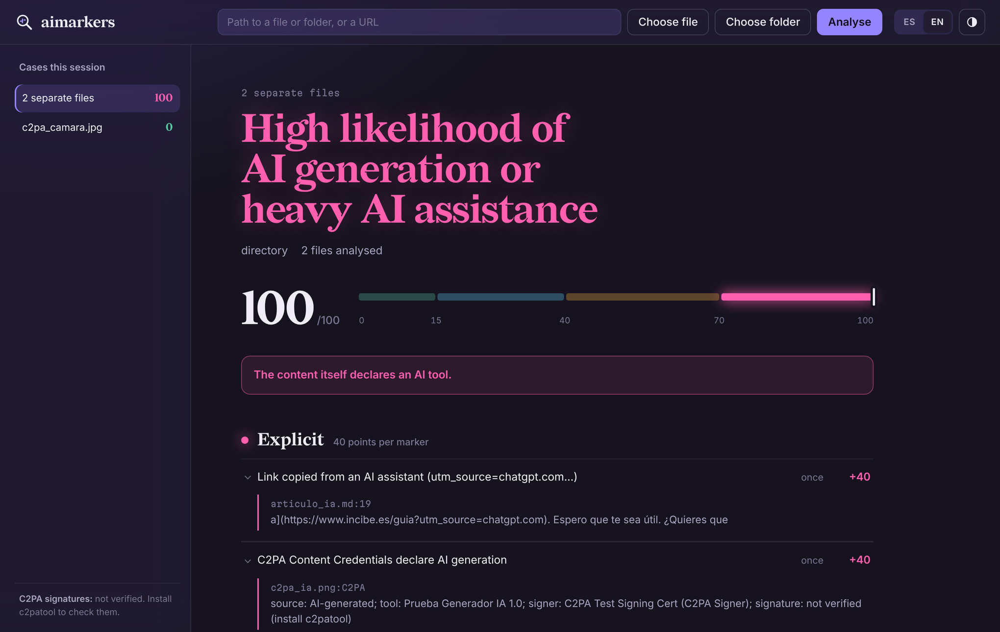
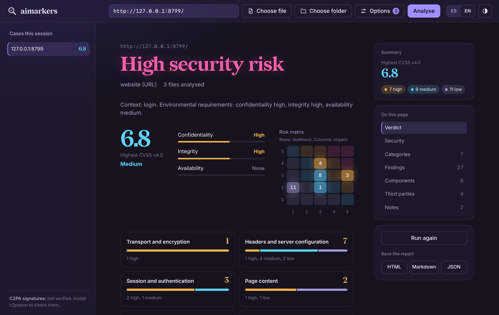

# aimarkers

**English** · [Español](README.es.md)

[](https://github.com/z115666/aimarkers/actions/workflows/ci.yml)
[](https://github.com/z115666/aimarkers/actions/workflows/codeql.yml)
[](LICENSE)


Command-line tool that looks for **AI markers** in source code, documentation, websites (HTML file or URL), **images** (C2PA Content Credentials, IPTC, EXIF and generation parameters) and Git repositories. It scores each sign by level and produces a report with the evidence, in English or Spanish. It can also crawl a whole website and run a **security assessment** (OWASP Top 10:2025, MITRE ATT&CK, CVSS v4.0 and a CIA risk matrix), including leaked secrets and **dependencies with known vulnerabilities** checked against OSV.dev.

It does not ask a language model whether something "sounds like AI": it looks for **evidence you can check** (declarations, tool fingerprints and traits) and tells you where it found each one. [How it decides](#how-it-decides) explains the criteria.

> Markers are signs, not proof. The tool helps you review; the conclusion is yours.

## Installation

### macOS with Homebrew

```bash
brew install z115666/tap/aimarkers
aimarkers --version

# Optional: cryptographic verification of C2PA signatures
brew install c2patool
```

To update: `brew update && brew upgrade aimarkers`.

### Any system (Windows, macOS, Linux)

```bash
git clone https://github.com/z115666/aimarkers.git
cd aimarkers
python3 aimarkers.py --version
```

Requirements: Python 3.9 or later and, to analyse history, `git` on the PATH. It only uses the standard library, so there are no dependencies to install. On Windows, see the next section. Optional extras:

- [`c2patool`](https://github.com/contentauth/c2pa-rs/tree/main/cli), to verify C2PA signatures.
- Pillow and NumPy, for the [pixel reading](#pixel-reading) of images: `python3 -m pip install pillow numpy` (with Homebrew: `"$(brew --prefix python@3.15)/bin/python3.15" -m pip install --user --break-system-packages pillow numpy`). Without them everything else works the same.

### Windows

1. Install Python and Git (PowerShell). When the Python installer asks, tick **Add python.exe to PATH**; with `winget` this is done for you:

   ```powershell
   winget install --id Python.Python.3.13 -e
   winget install --id Git.Git -e
   ```

   Close and reopen PowerShell, then check: `py --version` and `git --version`.

2. Download aimarkers into a folder of your choice:

   ```powershell
   cd $HOME
   git clone https://github.com/z115666/aimarkers.git
   cd aimarkers
   py aimarkers.py --version
   ```

   Without Git: on the repository page use **Code → Download ZIP**, extract it and open PowerShell in that folder.

3. Use it with `py` instead of `python3`, and Windows paths:

   ```powershell
   py aimarkers.py C:\Repos\my-project
   py aimarkers.py "$HOME\Downloads\image.png" --lang en
   py aimarkers.py https://example.com --html "$HOME\Desktop\report.html"
   start "$HOME\Desktop\report.html"
   ```

4. Optional: an `aimarkers` command in every PowerShell session. Add this line to your profile (`notepad $PROFILE`, create the file if it asks):

   ```powershell
   function aimarkers { py "$HOME\aimarkers\aimarkers.py" @args }
   ```

   If PowerShell refuses to load the profile, run once: `Set-ExecutionPolicy -Scope CurrentUser RemoteSigned`.

5. Optional, to verify C2PA signatures: download the Windows build of `c2patool` (`c2patool-…-x86_64-pc-windows-msvc.zip`) from the [c2pa-rs releases](https://github.com/contentauth/c2pa-rs/releases), extract `c2patool.exe` into a folder on your PATH, and check it with `c2patool --version`.

To update: `cd $HOME\aimarkers` and `git pull`. Colours work in Windows Terminal and in the classic console; use `--no-color` if you see odd characters. To fix the language: `$env:AIMARKERS_LANG = "en"` (session) or `setx AIMARKERS_LANG en` (permanent).

## Usage

If you installed it with Homebrew, use `aimarkers` instead of `python3 aimarkers.py` in the examples.

```bash
# A repository (files, images, Git history and branches)
python3 aimarkers.py ~/Projects/my-repo

# Individual files
python3 aimarkers.py report.md Clean-Temp.ps1

# Images
python3 aimarkers.py photo.jpg ~/Downloads/*.png

# A website by URL (downloads the page and its images, and checks /llms.txt)
python3 aimarkers.py https://example.com

# A page saved with "Save as…"
python3 aimarkers.py page.html

# Reports
python3 aimarkers.py ./project --html report.html --md report.md --json report.json
```

### Language

Output follows the system language (Spanish if the locale starts with `es`, English otherwise). To force it:

```bash
aimarkers --lang es report.md
AIMARKERS_LANG=en aimarkers report.md
```

The language applies to the console and the reports. Marker identifiers (`coautor-ia`, `c2pa-ia`…) and JSON keys do not change, so scripts that rely on them keep working.

### Options

| Option | What it does |
| --- | --- |
| `--html FILE` | Self-contained HTML report (light and dark mode, mobile friendly) |
| `--md FILE` | Markdown report |
| `--json FILE` | Full result as JSON, including `resumen_por_marcador` (per-marker summary) |
| `--lang es\|en` | Output language |
| `--evidence N` | Evidence items shown per marker (default 3) |
| `--threshold N` | Exit with code 2 if any target reaches N points (useful in CI) |
| `--no-images` | Do not analyse images linked from web pages |
| `--quiet` | Do not print the report to the console |
| `--no-color` | Plain console output |
| `--gui` | Open the graphical interface (see below) |
| `--crawl` | Crawl the whole site instead of a single page |
| `--max-pages N` / `--max-images N` / `--delay S` | Crawl limits (`-1` / `0`: no limit) and pause between requests |
| `--security` / `--security-only` | Add the security analysis / run only the security analysis |
| `--active --authorized` | Active security mode, only with authorisation (see below) |
| `--no-dns` | Skip the SPF, DMARC, DNSSEC and CAA checks |
| `--no-osv` | Do not check dependencies and JavaScript libraries against OSV.dev |
| `--ca PEM` | Also trust this CA or server certificate (internal sites with their own certificate) |
| `--trust-certificate` | Accept the analysed site's certificate even if it is not valid; that host only, and it stays as a finding |

If a site does not send its intermediate certificate (a common mistake after renewing a certificate), aimarkers downloads it from the address the certificate itself gives, as browsers do, and keeps verification on. It reports it as a finding so the server can be fixed.
| `--no-pixels` | Skip the pixel reading of images |
| `--cvss-threshold N` | Exit with code 3 if any security finding reaches CVSS N |

Every option also has a Spanish name: `--evidencias`, `--umbral`, `--sin-imagenes`, `--silencioso`, `--sin-color`, `--rastrear`, `--max-paginas`, `--max-imagenes`, `--retardo`, `--seguridad`, `--solo-seguridad`, `--sin-dns`, `--sin-osv`, `--sin-pixeles`, `--activo`, `--autorizado`, `--umbral-cvss`.

## Graphical interface

For those who prefer not to use the terminal, aimarkers includes a graphical interface that runs entirely on your computer:

```bash
aimarkers --gui                 # Homebrew
python3 aimarkers.py --gui      # macOS / Linux from the folder
py aimarkers.py --gui           # Windows
```

It opens in your browser. While it works it shows the overall percentage, an estimate of the time left, each phase of the analysis and, in plain words, what it is checking at each moment; **Stop analysis** cancels it if you started it by mistake. Drop files, folders or images onto the window, type a path or URL, or use **Choose file** / **Choose folder** (the system file picker). Each analysis stays in the side list for the session, and you can save the report as HTML, Markdown or JSON. It has light and dark appearance (or follows the system) and switches between English and Spanish. Press Ctrl+C in the terminal to close it.



How it is protected: it only listens on `127.0.0.1` on a random port; every request needs a random 256-bit token that travels in the URL fragment; it checks `Host` and `Origin` against DNS rebinding and other websites; it uses a strict Content Security Policy with no inline scripts or external resources; dropped files go to a temporary folder (50 MB per file, 500 MB in total) that is deleted on exit. Options: `--port N` and `--no-browser`.

## Crawling a whole website

By default aimarkers analyses only the page you give it (and up to 15 of its images). With `--crawl` it downloads the whole site:

```bash
aimarkers https://example.com --crawl                    # up to 2,000 pages, every image
aimarkers https://example.com --crawl --max-pages -1     # no page limit
aimarkers https://example.com --crawl --max-images 200 --delay 1
```

- Only pages on the same site (with or without `www.`), only over http(s).
- It respects `robots.txt` and `nofollow`, and pauses between requests (`--delay`, 0.3 s by default) so as not to overload the server.
- Everything is downloaded to a temporary folder that is **deleted when the analysis ends**, even if it fails. Total download limit: 2 GB.

## Security analysis

`--security` adds a security assessment to each target; `--security-only` skips the AI markers. Every finding includes:

- **OWASP Top 10:2025** category, **CWE** and **MITRE ATT&CK** techniques it enables.
- Effect on the **CIA triad** (confidentiality, integrity, availability).
- **CVSS v4.0** score computed inside the tool with FIRST's official algorithm (`cvss4.py`, checked against the reference calculator on 20,000 vectors). Each finding has a typical base vector; the threat metric (E) reflects whether there are public exploits, and the environmental requirements (CR, IR, AR) come from the **site's context**: login forms, personal data, payments or uploads raise them.
- Position in a **5×5 risk matrix** (likelihood × impact, as in ISO 27005): likelihood from CVSS exploitability and exploit maturity, impact from the effect on each CIA dimension weighted by the context.

**Websites, passive mode (default).** Only looks at what any visitor receives: HTTPS and redirection, certificate (validity, expiry and whether the server sends the full chain) and TLS version, HSTS, CSP, anti-framing, nosniff, Referrer-Policy, Permissions-Policy, version disclosure, CORS, cookie attributes, mixed content, third-party scripts without SRI, JavaScript libraries with known CVEs (jQuery, jQuery UI, Bootstrap, AngularJS, Lodash, Moment, Handlebars), forms over HTTP, passwords sent by GET, forms without anti-CSRF tokens, links vulnerable to reverse tabnabbing, sensitive HTML comments, detailed error messages, directory listing, exposed keys and tokens, source maps, `robots.txt` and `security.txt`.

**Email and DNS.** SPF, DMARC, DNSSEC and CAA of the domain, which protect families and staff against emails spoofing the domain. They are queried over DNS over HTTPS (Cloudflare, with Google as fallback): only the domain name is sent. `--no-dns` skips them.

**Privacy and third parties.** Lists every external service the pages load (analytics, advertising, video, fonts, maps, CDNs) and flags trackers, Google Fonts and YouTube embeds without privacy-enhanced mode, which matter under the GDPR on sites with minors or personal data.

**Component inventory.** CMS, plugins and themes with their versions, JavaScript libraries, web server and language: a starting point for the asset inventory and patch management.

**Segmented results.** Findings are grouped into categories (transport and encryption, headers, session, page content, components, information exposure, email and DNS, privacy, code), each with its own risk summary. In the interface you can regroup them by risk, category, OWASP or CIA dimension, and see the AI markers by file or page.

**Websites, active mode (`--active --authorized`).** Also requests well-known sensitive paths (`/.git`, `/.env`, backups and SQL dumps, `wp-config` copies, `phpinfo`, `server-status`, WordPress user enumeration and XML-RPC, admin panels), dangerous HTTP methods, CORS origin reflection and acceptance of TLS 1.0/1.1. It sends no injection payloads, no passwords and no exploits. **Only use it on websites you own or are authorised in writing to test**: unauthorised testing may be a crime (in Spain, article 197 bis of the Criminal Code). Without `--authorized` the tool refuses to start active mode.



**Code and files.** Hard-coded secrets (AWS, Google, Stripe, GitHub, GitLab, Slack, SendGrid, OpenAI, Anthropic, Hugging Face, npm, PyPI, Azure Storage, Twilio, Shopify, Mailchimp, Telegram bots, Teams and Discord webhooks, database URLs with a password, generic `password = "…"` assignments) and private keys, always shown truncated in the report, `.env` files, possible SQL and command injection, `eval`, insecure deserialisation, DOM XSS, disabled TLS verification, weak cryptography, non-cryptographic randomness for secrets, debug mode, silenced exceptions, unpinned dependencies, `curl | sh`, GitHub Actions not pinned to a SHA and containers running as root. These are pattern-based checks: they point to lines worth reviewing, not confirmed vulnerabilities.

**Dependencies with known vulnerabilities (OSV.dev).** aimarkers reads the exact versions in `requirements*.txt`, `poetry.lock`, `uv.lock`, `pdm.lock`, `Pipfile.lock`, `package-lock.json`, `npm-shrinkwrap.json`, `yarn.lock`, `composer.lock`, `Gemfile.lock`, `go.mod`, `Cargo.lock` and `packages.lock.json`, and checks them against [OSV.dev](https://osv.dev), the open vulnerability database that gathers GitHub, PyPI, npm, Go, RustSec and other advisories. For each vulnerable package it shows the advisories (CVE or GHSA), the worst published severity and the version that fixes all of them. On websites, the JavaScript libraries it detects are checked too, which completes its built-in list. Only the ecosystem, name and version of each package are sent, never code or paths; `--no-osv` (or **Query public databases** in the interface) turns it off. Whether the vulnerable part is actually used is up to you to check.

```bash
aimarkers https://my-site.example --security --crawl --html report.html
aimarkers ~/Projects/my-app --security-only --cvss-threshold 7     # exit code 3 if any finding reaches 7.0
```

## How it decides

aimarkers does not use a model to guess whether something "sounds like AI". Those classifiers flag formal writers and non-native speakers, and a light rewrite fools them. Instead it looks for three kinds of evidence, each tied to a place in the content you can open and check:

| Kind | What it is | Examples | Level |
| --- | --- | --- | --- |
| **Declarations** | The content or its metadata says it was made with AI | C2PA or IPTC `trainedAlgorithmicMedia`; Stable Diffusion or ComfyUI parameters in a PNG; `Co-Authored-By: Claude`; `🤖 Generated with…`; `utm_source=chatgpt.com`; ChatGPT citation residue (`oaicite`) | Explicit |
| **Tool fingerprints** | Traces left by a specific tool | `CLAUDE.md`, `.cursorrules`, `claude/…` branches, `data-lov-id` (Lovable), generator names in EXIF, chat leftovers ("Sure! Here is the updated…") | Strong |
| **Traits** | Habits frequent in generated content, but also found in human work | "In a real application…" comments, `your_api_key_here`, emojis in logs, stock phrases, em dashes, uniform rhythm; in images, the pixel reading | Medium or weak |

What it reads depends on the type of content:

- **Code, text and web pages**: the content itself (declarations, fingerprints and traits) and, on websites, the HTML structure and embedded data. Writing style only counts above 150 words and by density, never for a single word.
- **Images**: first their metadata (C2PA, IPTC, EXIF, PNG text), which is the only thing that can give a firm answer; then, if Pillow and NumPy are installed, a [pixel reading](#pixel-reading) that can only add weak or medium signs.
- **Git repositories**: commit trailers and footers, bot authors, agent branches and agent instruction files.
- **Office documents and PDF** (`.docx`, `.pptx`, `.xlsx`, `.odt`, `.odp`, `.ods`, `.pdf`): their metadata, their text and the images inside them. See [Documents](#office-documents-and-pdf).

A single explicit marker is enough to say the content declares AI involvement. Traits on their own only ever reach "weak signs" or "likely assistance", and the absence of markers proves nothing.

## Scoring

| Level | Weight | Examples |
| --- | --- | --- |
| Explicit | 40 | `Co-Authored-By: Claude`, `🤖 Generated with Claude Code`, `utm_source=chatgpt.com`, author `copilot-swe-agent[bot]`, C2PA or IPTC declaring an AI-generated image, Stable Diffusion parameters |
| Strong | 20 | `CLAUDE.md`, `.cursorrules`, `.claude/`, `data-lov-id` (Lovable), "Sure! Here is the updated…", branch `claude/…`, `Software: Midjourney` in EXIF |
| Medium | 8 | "In a real application…" comments, `your_api_key_here`, emojis in logs, bursts of records created 2 s apart |
| Weak | 3 | Density of LLM stock phrases, em dashes (—), uniform docstrings, uniform sentence rhythm |

- A repeated marker adds up with diminishing returns, up to 3 times its weight.
- In projects with 10 or more files, **medium and weak** markers are weighted by prevalence: they score in full when they affect 10% of the files and proportionally less when they are isolated.
- Writing style is not assessed below 150 words.
- The score is capped at 100.

| Score | Assessment |
| --- | --- |
| 0–14 | No relevant signs (or "weak signs" if there is any medium or strong marker) |
| 15–39 | Weak signs |
| 40–69 | Likely AI assistance in part of the content |
| 70–100 | High likelihood of AI generation or heavy AI assistance |

## What it analyses

- **Code** (`.py`, `.ps1`, `.js`, `.ts`, `.sh`, `.cs`, `.go`…): tool signatures, chat leftovers, files wrapped in ```` ``` ```` fences, demo comments, placeholders, emojis in logs, numbered steps, uniform docstrings, generic error handling, unusual typography in code.
- **Text** (`.md`, `.txt`, `.rst`…): ChatGPT citation residue (`oaicite`, `turn0search0`), links with `utm_source=chatgpt.com`, chat closings, `[Company Name]` placeholders, stock phrases in English and Spanish, "**Term:**" bullets, emoji headings, sentence rhythm.
- **Websites**: fingerprints of Lovable, v0, Bolt, Readdy, Base44 and similar; images named after generators (`ChatGPT Image…`, `DALL·E`, `Gemini_Generated_Image`); the default stack of AI builders; the `vinext` framework; **embedded data** (bursts of `created_at` values and coordinate precision); the visible text with the text rules; and the **metadata of the page's images**.
- **Images** (`.jpg`, `.png`, `.webp`, `.heic`, `.avif`, `.tif`…): see the next section.
- **Git repositories**: `Co-authored-by` trailers, "Generated with" footers, bot authors, agent branches, huge commits, uniform messages; plus agent files and folders (`CLAUDE.md`, `AGENTS.md`, `.cursor/`, `.github/copilot-instructions.md`…).

It skips `node_modules`, `.venv`, `dist`, `build`, `.git` (as files) and minified code.

## Images: C2PA and other metadata

[C2PA](https://c2pa.org/) (*Content Credentials*) is an open standard for attaching a **signed manifest** to a file that records its provenance: which tool created it, which actions were applied and whether it was generated with AI. It is used by ChatGPT/DALL·E, Adobe Firefly, Microsoft Designer, Google and some cameras (Leica, Sony, Nikon), among others. The manifest is stored inside the image in JUMBF boxes holding CBOR data and a COSE signature with an X.509 certificate.

aimarkers reads, with no dependencies:

| Source | Where it lives | What it looks for | Level |
| --- | --- | --- | --- |
| C2PA manifest | JPEG (APP11), PNG (`caBX`), WebP (`C2PA`), HEIC/AVIF/TIFF | `digitalSourceType` = `trainedAlgorithmicMedia` (AI-generated) or `compositeWithTrainedAlgorithmicMedia` (AI-edited); an AI tool as claim generator or `softwareAgent`. It also shows the certificate signer | Explicit |
| IPTC in XMP | `Iptc4xmpExt:DigitalSourceType` | The same digital source type values | Explicit |
| PNG text | `tEXt`, `zTXt`, `iTXt` | Stable Diffusion `parameters` (A1111/Forge), ComfyUI `prompt`/`workflow`, InvokeAI, NovelAI | Explicit |
| EXIF and XMP | `Software`, `Artist`, `ImageDescription`, `CreatorTool`… | Generator names (Midjourney, DALL·E, Firefly, Stable Diffusion, Gemini…) | Strong |

A C2PA manifest **without** an AI declaration (for example, a camera photo) does not score: it appears as a note with the source, tool and signer.

**Signature verification.** aimarkers parses the manifest but does not verify the cryptography. If `c2patool` is installed (`brew install c2patool`), it uses it to check that the signature is valid and that the image has not been modified after signing, and says so in the evidence: "valid, trusted certificate", "valid, unrecognised certificate" or "INVALID". Without `c2patool` the evidence says "not verified".

**Limits.** Metadata is easily lost: screenshots, many social networks and many editors strip it. The absence of C2PA means nothing. An unverified manifest can be forged; install `c2patool` for a firm conclusion.

**Images on websites.** In URL mode, aimarkers downloads up to 15 images from the page (``, `og:image`, `twitter:image`), over http(s) only and up to 15 MB each, into a temporary folder that is deleted afterwards. With a local HTML file it only analyses images inside the HTML file's folder. `--no-images` turns both off.

### Pixel reading

Metadata is lost when an image is screenshotted, re-saved or uploaded to most social networks, so aimarkers also measures the image itself. It is not a trained classifier: it takes three classic forensic readings on a 1024×1024 crop from the centre, without resizing (resizing would erase what it measures).

| Reading | What it measures | Signal when |
| --- | --- | --- |
| Sensor noise | Spread of the high-frequency residual (each pixel minus the mean of its four neighbours) in 16×16 blocks. Cameras leave noise even on smooth areas | median < 0.8 and quietest 10 % < 0.5 |
| Periodic trace | Peak, in the averaged spectrum of that residual, on the 8-pixel grid where diffusion decoders (VAE) and GANs upsample | ≥ 3.5 |
| Size | Matches a common generator output (512×512, 1024×1024, 1024×1792, 1344×768…) | only adds to another signal |
| Camera | Make and model in EXIF | if present, nothing is scored |

One signal adds a weak marker (3 points) and two add a medium one (8 points); the pixel reading never reaches strong or explicit. Screenshots, logos and flat graphics are skipped, and so are images under 256 px.

**How reliable it is.** The thresholds were set on 32 real photos (cameras, COCO, PASCAL VOC and classic test images) and 29 single generated images (Stable Diffusion 1.x, SDXL, FLUX, DALL·E 2 and ProGAN), also recompressed as JPEG at quality 90. With them, **no real photo was flagged** and **about 1 in 4 generated images was** (7–8 of 29). A "normal" reading therefore does not mean the image is real. It is a small sample: take it as an indication. CGI renders and heavily retouched or denoised photos can show "no sensor noise". For a firmer answer, look for the original, check its C2PA credentials, or use a detector trained on recent generators.

### Office documents and PDF

Word, PowerPoint and Excel (`.docx`, `.pptx`, `.xlsx` and their macro versions), LibreOffice (`.odt`, `.odp`, `.ods`) and PDF. For each document aimarkers reads:

- **Metadata**: application, producer and custom properties. An AI tool named there (ChatGPT, Copilot, Gemini, Claude, Gamma, Beautiful.ai, Tome…) is a strong marker, also as the author of a tracked change or comment. Libraries that assistants use to create files from code are a medium marker: python-docx, python-pptx, openpyxl, XlsxWriter, PptxGenJS, docx, ReportLab, FPDF, pdf-lib, jsPDF, PDFKit, WeasyPrint, wkhtmltopdf and headless Chrome. Any automation uses them too, so on their own they do not prove AI. Author names are never copied into the report.
- **Text**: the same rules as any text, plus **literal Markdown** (`### Heading`, `**bold**`, `|` tables), which in a Word or PDF file usually means a chat answer was pasted in.
- **Embedded images**, with the same metadata and pixel analysis as any image. An AI image with C2PA credentials inside a presentation is found.

PDF text is read with the standard library when the PDF uses simple fonts (as ReportLab does). With embedded fonts, install pypdf (`python3 -m pip install pypdf`) to analyse the text too.

### Screenshots

aimarkers also looks for fake or edited screenshots. It recognises screenshots and flat graphics and, on them, runs these checks:

| Check | What it looks at | Result |
| --- | --- | --- |
| Origin | Metadata of the tool that took it (macOS and iOS, GNOME, KDE Spectacle, ShareX, Greenshot, Flameshot, Snipping Tool) or a screenshot-like file name | Context, not scored |
| Screen size | Matches a real phone, tablet or computer screen | Context, not scored |
| Generator size | Looks like a screenshot, matches no usual screen, matches a generator output (ChatGPT delivers 1024×1536) and declares no screenshot tool | Medium marker |
| Pasted areas | In a lossless image (PNG, lossless WebP, TIFF, BMP), 128-pixel areas whose DCT coefficients cluster on a JPEG quantisation grid while the rest do not. It shows roughly where, and the offset of that JPEG grid | A note and a highlighted row |

Pasted areas are not scored as AI: they point to editing, and they can also be a photo that was on screen. In tests with 19 genuine screenshots there were **no false alarms**; with crops of other screenshots pasted on top, it found about **1 in 3 large pastes** (600×400 px, JPEG quality 70–85) and very few small or high-quality ones. Text changed in place (browser inspector, paint tools) leaves no trace it can see. To confirm a screenshot, compare it with the original or ask for the source.

## Excluding files

Add `aimarkers: ignore-file` in the first lines of a file to skip it. `aimarkers.py` itself uses it, because it contains every pattern it looks for.

Note: the `tests/fixtures/` folder deliberately contains examples with markers. If you analyse the whole tool folder, it will score high.

## Tests

```bash
python3 -m unittest discover tests -v
```

They include positive cases (code, text, a generated website, a repository with agent commits built on the fly, a synthetic website with a bulk data load, images with signed C2PA, IPTC, EXIF and Stable Diffusion and ComfyUI parameters) and negative cases (handwritten notes, the Python standard library, a camera photo with C2PA and another with normal EXIF). They also test hostile input: decompression bombs, malformed JUMBF boxes and randomly corrupted images.

For development, install the analysis tools with pinned versions and hashes:

```bash
python3 -m pip install --require-hashes --no-deps -r requirements-dev.txt
ruff check .
bandit -c pyproject.toml -r aimarkers*.py cvss4.py
```

Validation done: the Python standard library (11,630 files) scores 3/100; 400 system images give no false positives; a real website with 144 records loaded in 5 minutes is detected as a burst; the `psf/requests` repository scores 48/100 because of a real March 2026 commit with `Co-Authored-By: Claude Opus 4.6`.

## Extending the rules

The rules are at the top of `aimarkers.py`, in lists of `(id, level, pattern)` tuples. Descriptions in both languages are in the `DESCRIPCIONES` dictionary, and all other texts in `TEXTOS`.

- `REGLAS_GENERALES`: applied to everything.
- `REGLAS_CHAT` and `REGLA_HUECO`: chat leftovers.
- `REGLAS_CODIGO_LINEA`: line by line in code.
- `REGLAS_HTML`: websites.
- `RE_GENERADOR_META`: generator names in image metadata.
- `aimarkers_pixeles.py`: pixel reading thresholds; `aimarkers_dependencias.py`: lock file readers and the OSV.dev client.
- `gui/`: graphical interface (HTML, CSS and JavaScript with no dependencies) served by `aimarkers_gui.py`.
- `MULETILLAS_ES` / `MULETILLAS_EN`: stock phrases (they only count by density).
- `FICHEROS_AGENTE` / `DIRS_AGENTE`: agent file and folder names.

Add the rule and its Spanish and English description, create a fixture in `tests/fixtures/` and a test in `tests/test_aimarkers.py`.

## Security

aimarkers is designed to analyse untrusted content. It runs `git` with a hardened configuration so that a tampered repository cannot execute commands (hooks, `fsmonitor`, `textconv`), bounds regular expressions against ReDoS, limits decompression and nesting depth when reading images, does not follow symbolic links, limits sizes and only downloads over http(s). Details, the threat model and how to report vulnerabilities are in [SECURITY.md](SECURITY.md).

## Limitations

- It does not check whether code calls invented APIs: that requires running it or checking it against the documentation.
- Without metadata, it can only give weak or medium signs about an image, and it misses most generated images (see [pixel reading](#pixel-reading)). It does not read invisible watermarks such as SynthID.
- Pasted areas in screenshots are only found when they went through JPEG and are large (about 1 in 3 pastes of 600×400 px; small ones almost never). Text edited in place, with the browser inspector or a paint tool, leaves no trace it can see.
- In PDFs with embedded fonts, the text can only be read with pypdf installed; without it, only metadata and images are analysed.
- The absence of markers does not prove human authorship: trailers and footers can be removed, text can be rewritten and metadata can be stripped.
- The security analysis is automated and non-intrusive: it does not replace an audit or a penetration test, and its CVSS scores start from typical vectors that you should review.
- URLs that need JavaScript to render content are analysed only by their initial HTML. In that case, save the page from the browser and analyse the file.

---
Author: Alberto · [MIT License](LICENSE) · `cvss4.py` is a translation of FIRST's CVSS v4.0 calculator (BSD-2-Clause, notice in the file) · Fonts under the SIL Open Font License ([gui/fonts](gui/fonts/README.md))
